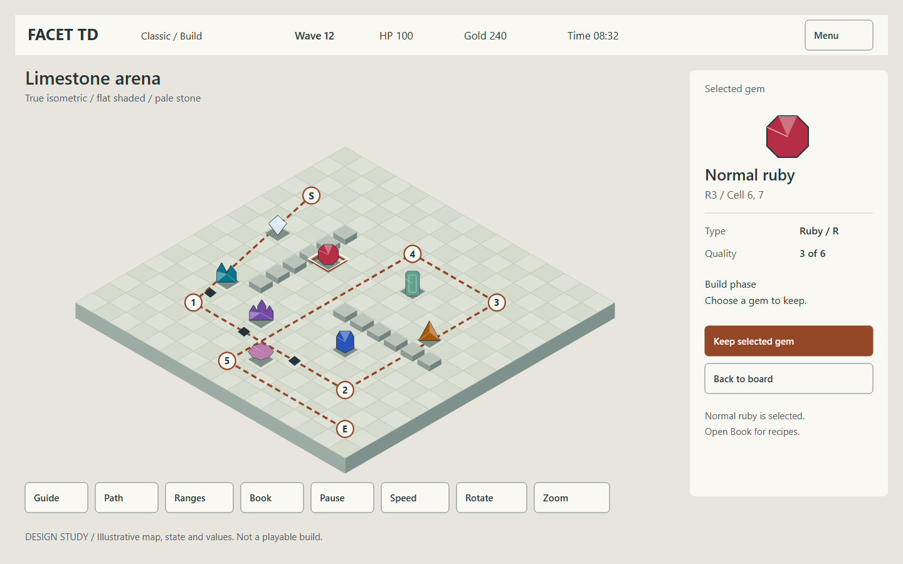
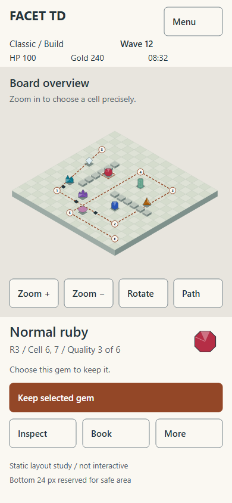

# P1.5 art and UI direction

Start with the compact [direction sheet](DIRECTION.md).

- [Desktop reference mockup](desktop.svg): light mineral board and a separate inspector.
- [Phone reference mockup](phone.svg): camera row and labeled context actions.
- [Gem readability reference](gems.svg): eight silhouettes, grayscale comparison, six quality tiers.
- [HUD wireframe](hud-wireframe.svg): desktop, tablet, portrait and short landscape rules.

These are static vector studies, not a game build. Their reduced board, paths, values and selected state are illustrative. Reference controls are not interactive. Keep only actions that the converted Classic rules allow.

## Evidence reused

- `docs/PLAN.md`: orthographic 3D board, procedural art, Preact DOM overlay and offline delivery.
- Vault: **Generate GemTD UI revamp mockups**, **Render GemTD UI mockup direction**, **Audit GemTD UI UX accessibility**, **Remediate GemTD UI UX accessibility audit**.
- Existing GemTD `theme/mockup-a2.html`, `theme/shots/a2-desktop.png`, `HANDOVER.md` and `theme/theme-audit.md` under `C:/Jasper/Codex/.tmp/gemtd-ui-audit/`: retain measured HUD space, 48 px targets, visible labels, board selection and focus handling. The earlier obsidian palette is replaced at the user's request.
- Extracted VPK `out/resource_addon_english.txt`, base-gem entries `gemtd_d1` through `gemtd_p111111`: eight types and six quality tiers. The VPK owns gameplay; GemTD is a UI reference.

## Status and validation

The bright identity follows the user's explicit choice. Camera, palette values, scale caps and layout are the P1.5 implementation baseline, recorded in the Vault Decision **Facet TD mineral-and-stone art direction**. Runtime gates remain in DIRECTION.md; P1.5 does not implement them.

## Review evidence

PNG files in `previews/` are Chromium captures of the adjacent authored SVG studies, at their native dimensions. They use no external assets or fonts. They are derived previews, not AI-generated reference images.

Local checks: four SVG files parse with accessible titles; Chromium rendered all four with no text outside their viewports. Contrast checks passed for body text, secondary text, copper actions, control borders, focus and selected-cell edges. These checks do not establish runtime accessibility or touch behavior.

