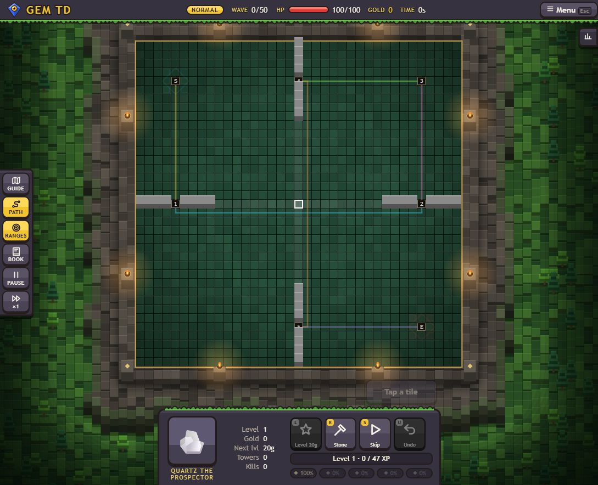
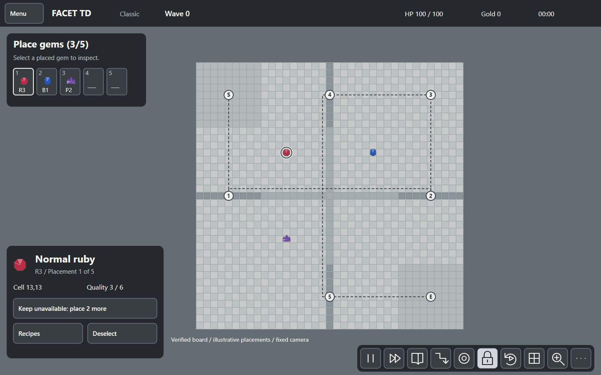
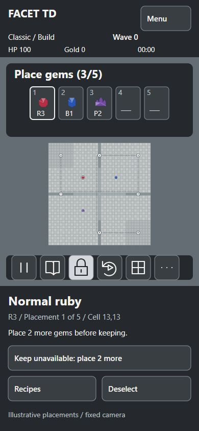

# P1.5 art and UI direction

Start with the compact [direction sheet](DIRECTION.md).

[Stone and basic gem 3D models](model-study/README.md): reusable three.js faceted rock walls and gem-crowned masonry towers, animated wall joins, eight gem towers and a standalone interactive preview.

- [Desktop reference mockup](desktop.svg): cave-grey arena, top-left five-gem quick selection, lower-left selection info and lower-right icon-only tools.
- [Top-down desktop mockup](top-view.svg): the same verified board and HUD, with an Iso view return button.
- [Phone reference mockup](phone.svg): grey status and selection panels, five-gem summary and compact icon tools.
- [Top-down phone mockup](phone-top.svg): square board with the view toggle still visible.
- [Gem readability reference](gems.svg): eight silhouettes, grayscale comparison, six quality tiers.
- [HUD wireframe](hud-wireframe.svg): desktop, tablet, portrait and short landscape rules.

These are static vector studies, not a game build. Their board geometry and marker order now match the current GemTD board source, checked against the opened local game. See [BOARD.md](BOARD.md) for coordinates, walls, route checks and original VPK offsets. HUD state and values remain illustrative. Reference controls are not interactive. Keep only actions that the converted Classic rules allow.

## Evidence reused

- `docs/PLAN.md`: orthographic 3D board, procedural art, Preact DOM overlay and offline delivery.
- Vault: **Generate GemTD UI revamp mockups**, **Render GemTD UI mockup direction**, **Audit GemTD UI UX accessibility**, **Remediate GemTD UI UX accessibility audit**.
- Existing GemTD `theme/mockup-a2.html`, `theme/shots/a2-desktop.png`, `HANDOVER.md` and `theme/theme-audit.md` under `C:/Jasper/Codex/.tmp/gemtd-ui-audit/`: retain measured HUD space, 48 px targets, visible labels, board selection and focus handling. The earlier full-dark world is replaced at the user's request; the later reference restores dark HUD surfaces over the bright arena.
- Extracted VPK `out/resource_addon_english.txt`, base-gem entries `gemtd_d1` through `gemtd_p111111`: eight types and six quality tiers. The VPK owns gameplay; GemTD is a UI reference.

## User reference

Later references, received 25 October 2026: [arena with rock-ridge walls and large creeps](references/user-arena-2.png) and [end-of-run summary](references/user-end-card.png). The model study adopts the ridge walls and creep scale; the summary layout is specified in [IMPLEMENTATION.md](IMPLEMENTATION.md#end-of-run-summary). Both are inspiration only.

[Original supplied screenshot](references/user-ui.png), received 25 October 2026. It supplies composition and mood: a large bright arena, a compact status bar, upper-left build guidance, lower-left gem/recipe inspector and grouped bottom-right controls. Publisher and asset licensing are unknown; use it as visual inspiration. Build original procedural scenery and use VPK-derived gameplay data.

The latest studies use the user-requested cave-grey palette, lower-right icon-only tools, lower-left context info and selectable five-gem summary. This supersedes the forest-green/mint palette. Fixed-angle and unlocked board rotation complement the Isometric / Top toggle. The camera now supports toggleable isometric and top-down modes. Both preserve selection, logical pan anchor, relative rotation offset and relative zoom. Background styling is deferred; the studies use a neutral slate-grey backdrop. The model caps, eight gem silhouettes, six tiers and accessible input requirements continue. Phone sheets reserve board space; desktop floating panels must remain outside projected playable cells.

## Status and validation

The bright identity follows the user's explicit choice. Both camera modes, palette values, scale caps and layout are the P1.5 implementation baseline, recorded in the Vault Decision **Facet TD mineral-and-stone art direction**. Runtime gates remain in DIRECTION.md; P1.5 does not implement them.

## Review evidence

PNG files in `previews/` are Chromium captures of the adjacent authored SVG studies, at their native dimensions. They use no external assets or fonts. The three displayed current-round gem placements are illustrative; all five placement slots are UI summaries of board entities, not a separate draft. The supplied screenshot is retained separately as reference material and is not composited into these studies. They are derived previews, not AI-generated reference images.

Local checks: six SVG files parse with accessible titles; Chromium rendered all six with no text outside their viewports. Contrast checks passed for body text, secondary text, grey actions, control borders, focus and selected-cell edges. The revised isometric/top-down desktop and phone studies and HUD wireframe were rendered and inspected. Projection and toggle behavior still require runtime validation. These checks do not establish runtime accessibility or touch behavior.

## Art-style options

[Faceted, voxel and hybrid cave mockups](style-studies/README.md) compare three art treatments using the same HUD and board composition. They are review options; the source-verified board specification remains unchanged.

[Connected cave revision](style-studies/d-connected-hybrid.png) adds the requested entrance/goal continuity. The original gems protect a castle; a crystal vault is the proposed visual interpretation. See the [environment and goal handoff](IMPLEMENTATION.md).

[Corrected E-to-castle approach: four isometric rotations and top view](camera-studies/README.md) supersedes the ambiguous connection in concept D.

## Environment first

[Interactive Three.js sunken cave blockout](environment/README.md): continuous floor, wall-embedded fixed openings, camera rotation, top view and foreground cutaways. [Future model brief](environment/MODEL_BRIEF.md) records the latest requirements. Earlier generated images remain inspiration; their bridges and camera-facing architecture are superseded.

## Phase 1.5 completion

Camera, material/palette, desktop/mobile HUD direction and the environment blockout are delivered. The [final model handoff](model-study/FINALIZATION.md) adds all 46 tower designs, connected walls, source-ability identities, body trims, ambient particles and validation evidence. Open [the offline model study](model-study/preview/index.html) or [the cave blockout instructions](environment/README.md). Runtime adoption, gameplay occlusion, final creep art/combat effects and target-device FPS validation belong to P2-P4.
