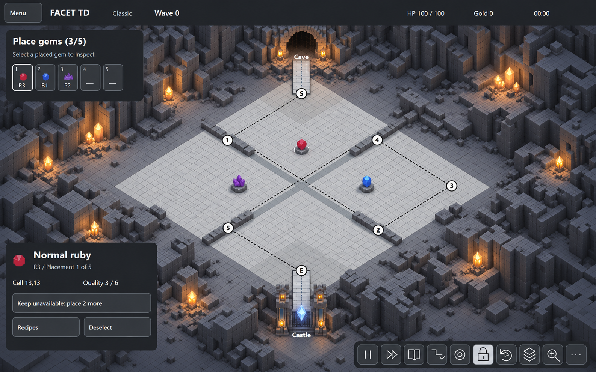
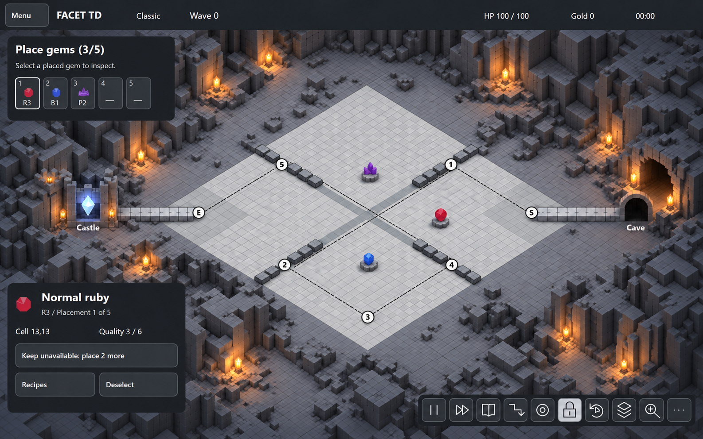
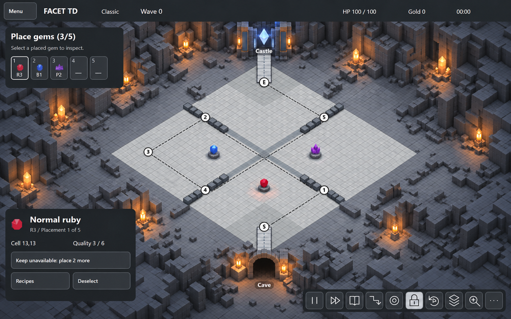
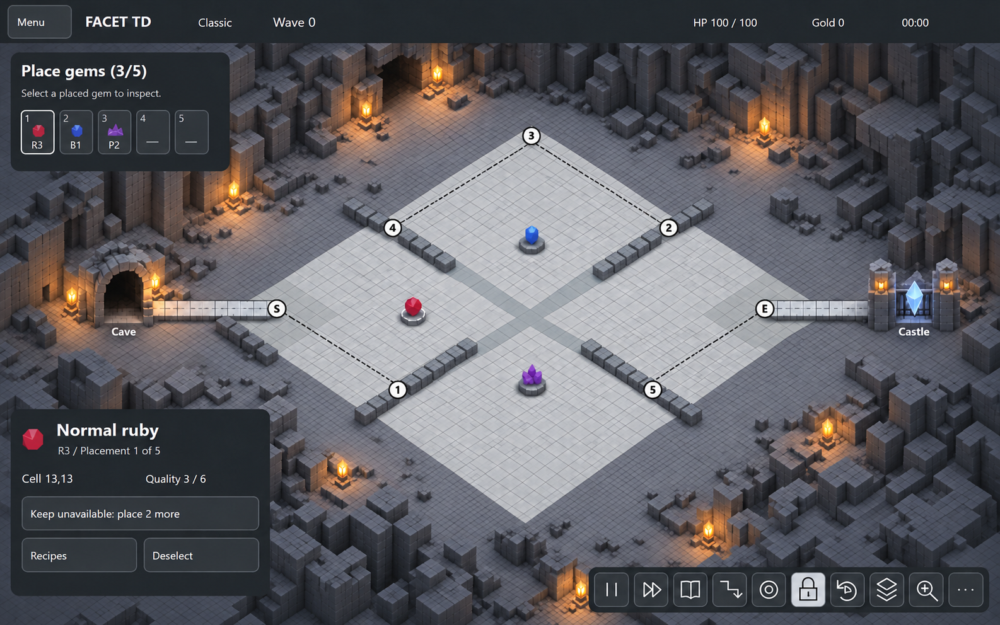
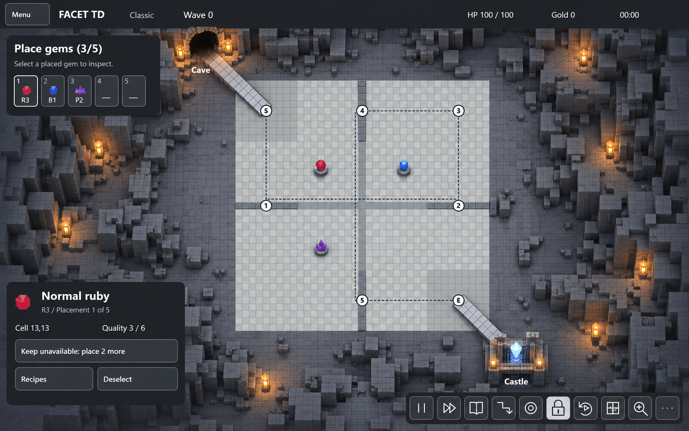

# Four isometric angles and top view

25 October 2026. These replace the ambiguous castle approach in the earlier connected-cave concept. **Only E connects to the castle. Checkpoint 2 has no castle branch.** Cave and castle positions follow fixed world anchors through all views; the HUD stays screen-fixed.

| View | Mockup | Castle / entrance on screen |
| --- | --- | --- |
| Isometric 0° | [Open](iso-000.png) | Castle below E; cave above S |
| Isometric +90° | [Open](iso-090.png) | Castle left of E; cave right of S |
| Isometric +180° | [Open](iso-180.png) | Castle above E; cave below S |
| Isometric +270° | [Open](iso-270.png) | Castle right of E; cave left of S |
| Top | [Open](top.png) | Castle beyond lower-right E; cave beyond upper-left S |

## Geometry and provenance

The checked vector references and their PNG captures are in `references/`. They project the same [board reference](../board-reference.json), seven labeled cells and four wall arms into each view. [geometry.json](geometry.json) records marker screen positions and the cosmetic castle-approach endpoints. The approach begins at the center of E (zero-based cell 32,32) and extends outward along the board's southeast diagonal. Checkpoint 2 (cell 32,18) is a separate anchor. The entrance mirrors this beyond S at the northwest corner. There is one castle approach, without a branch from 2.

These extensions illustrate environment attachment. They are not added simulation waypoints, a changed Classic goal trigger, or replacements for the original VPK anchors documented in [BOARD.md](../BOARD.md).

Generated with built-in `image_gen.imagegen`. For each view, its own reference drawing supplied geometry/camera/HUD, while the previous hybrid cave image supplied material style only. [prompts.json](prompts.json) preserves all five initial prompts and three targeted wall-repair prompts. Three initial rotated images flattened or omitted wall arms; their final revisions restore the four short arms. Original generated outputs remain in the Codex generated-images folder; this directory contains the selected final five.

The final images were visually reviewed for seven marker labels, E-only castle approach, S-only entrance, four wall arms and the screen-fixed grey HUD. Exact render-to-render tile counts, surrounding rock placement and model dimensions are still illustrative. Use the checked references for implementation geometry; runtime camera picking, transition behavior and occlusion remain P2 checks.

## Latest environment correction

No bridge is required at either endpoint. Use unobstructed continuous cave floor, with the entrance and castle embedded in the sunken chamber walls and fixed in world orientation. The [model brief](../environment/MODEL_BRIEF.md) supersedes these details in the retained concept images; the [actual Three.js blockout](../environment/README.md) demonstrates the spatial arrangement.
