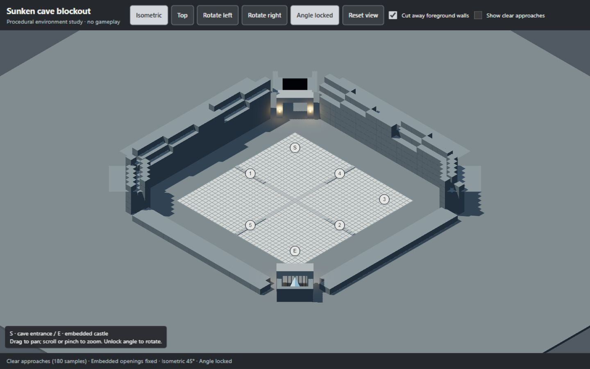
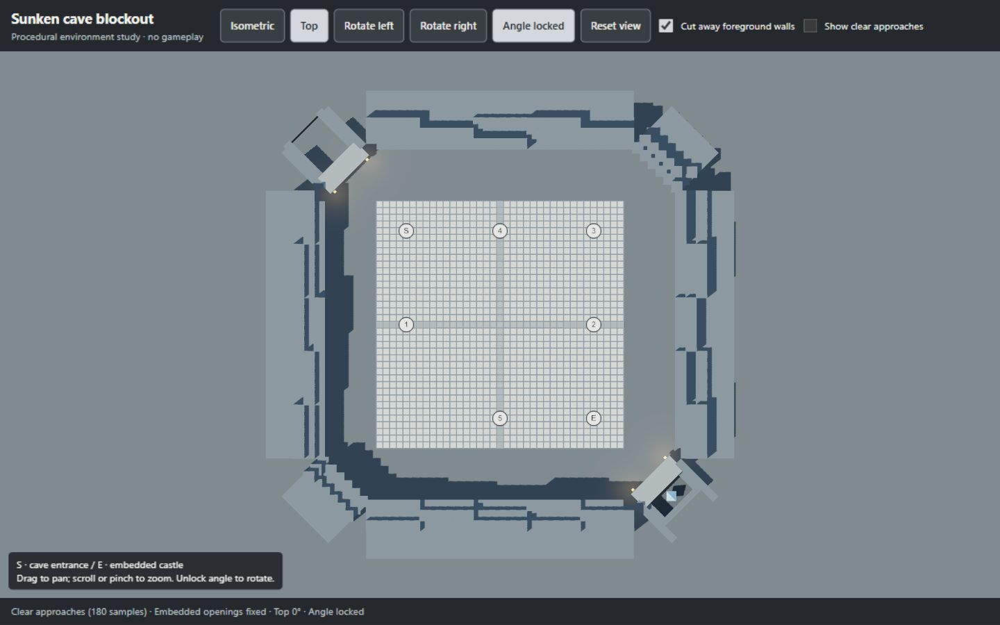

# Sunken cave environment blockout

A real, interactive Three.js scene built from procedural geometry. No imported models, generated images, new packages or CDN are required. This is a P1.5 environment study, separate from game source.

## Open

From this checkout run:

```powershell
python docs/art/environment/serve.py
```

Open [the local preview](http://127.0.0.1:8768/environment/). Python 3.9+ and the repository's installed Three.js dependency are required. In a linked worktree, the server finds the primary checkout's installed dependency through Git's common directory. It serves only on loopback.

## Inspect

Use Isometric / Top, quarter-turn buttons, angle lock, drag and zoom. Locked drag pans; unlocked drag rotates at fixed elevation. Reset restores the current view's default framing. Foreground rock cuts away as the camera turns; turn off cutaway to inspect the full chamber.

The arena sits on the lower floor of an octagonal cave. The entrance and defended castle are embedded in opposite cave walls, facing inward with fixed world transforms. Both approaches use the continuous chamber floor: **no bridges, elevated connectors or chasms**. Rock is excluded around S and E; checkpoint 2 has no castle branch. Labels face the camera; architecture does not.

The board uses the checked 37 × 37 UI reference, with 32 fixed-wall cells. It is not the final VPK coordinate conversion or a running simulation. The protected crystal remains a visual proposal for the original castle.

## Evidence and limits

Browser checked at 1440 × 900 and 390 × 844: all four isometric quarter-turns, top view, repeated mode switches, free rotation, locking at a non-default angle, panning, reset and both overlays. No browser console errors; narrow layout has no horizontal overflow. JavaScript and Python syntax checks pass.

Startup checks assert reference dimensions, 32 wall cells and 180 unobstructed samples across the two approach lanes. The study reserves 3.2-cell lanes and checks three lateral sample tracks below 2.3 cells of height, stopping before the intended castle gate. Landmark transforms are asserted unchanged on every render. This sampled geometric check is not full collision, navmesh or boss-size certification.

Final materials, detailed rock silhouettes, gameplay integration, full accessibility and performance profiling remain future work. [The model brief](MODEL_BRIEF.md) records the user's corrections for later asset generation. Modular GLB assets can replace these simple meshes after proportions and camera visibility are approved; a complete imported cave model is unnecessary.




