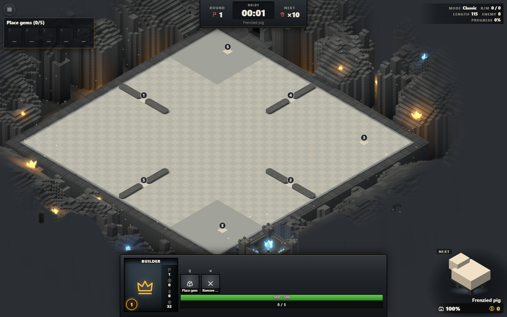
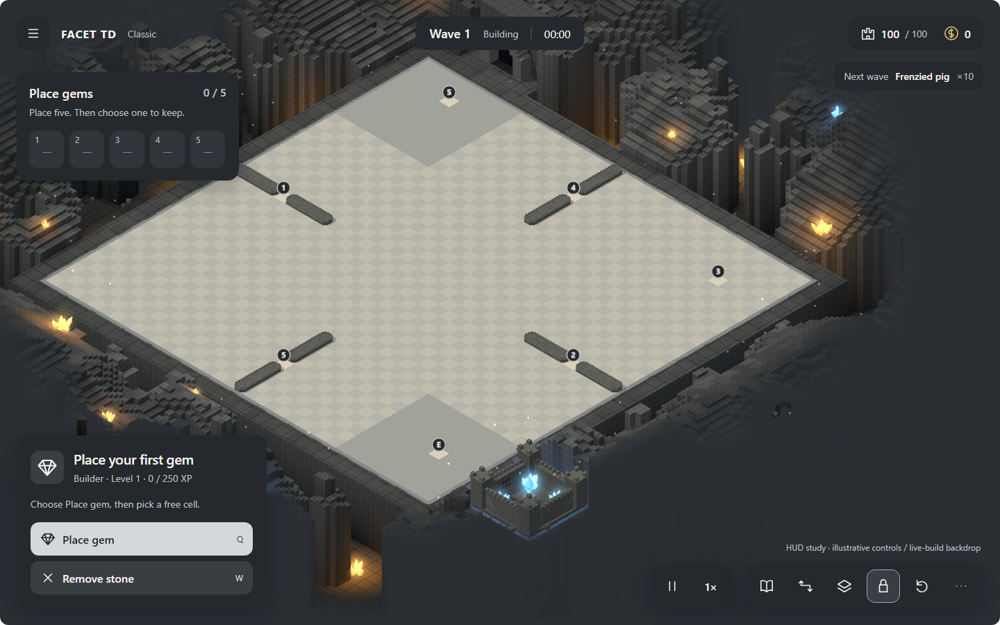
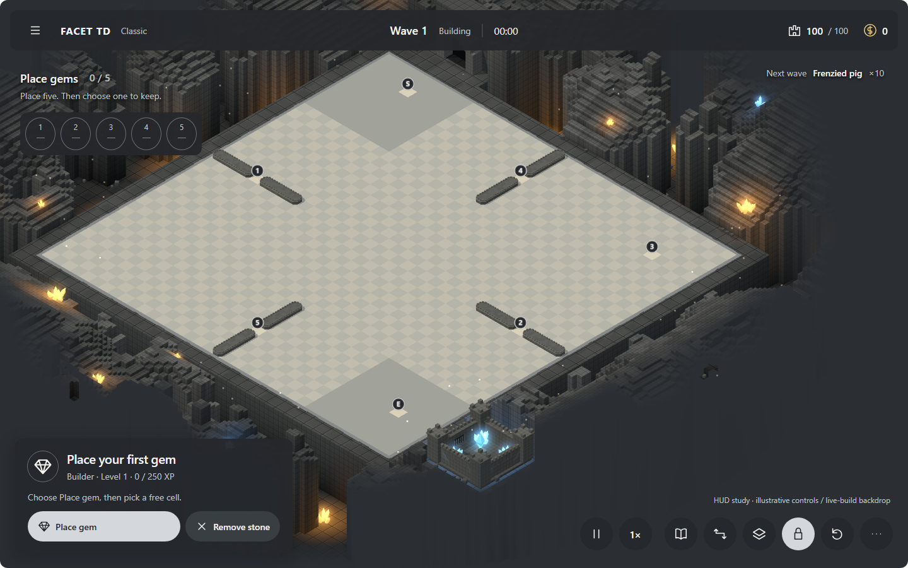

# HUD audit and two refinement studies

29 October 2026 · incumbent source: `da21e57` · proposals for phase 1.5.

Open [the comparison](index.html), [Floating Slate](version-a.html), or
[Mineral Ribbon](version-b.html). The individual previews are most useful at
1440 px wide, where control sizes are shown at their intended desktop scale.

**Recommendation: Floating Slate.** It most closely restores the agreed phase
1.5 composition and gives the next action a clear place. Mineral Ribbon is the
alternative for a lighter interface with more exposed scenery. Neither is an
adopted design decision or an implemented game HUD.

## Audit

The review compares the current build with [DIRECTION.md](../DIRECTION.md),
[IMPLEMENTATION.md](../IMPLEMENTATION.md), and the supplied UI reference.
The current HUD was built and captured from the same checkout, using seed 42.
This is a focused visual and source audit, not full gameplay or accessibility
certification.

| Priority | Finding and evidence | Proposed treatment |
| --- | --- | --- |
| P1 | Repeated bevels dominate hierarchy. `src/style.css:36`, `.panel`, the base button rules and `.cmd` combine dark borders, inset lips, gradients and hard offset shadows. Large panels and minor commands all receive similar weight. | One opaque charcoal surface and one soft shadow; flat raised controls; pale grey reserved for the main action. |
| P1 | The current command card occupies the lower centre, while the showcase puts castle HP and gold below a large model. `Hud.tsx` documents this Dota-style layout. The first-wave capture shows a broad command slab holding just two actions. This differs from the 1.5 lower-left inspector and lower-right utilities. | Restore the corner composition; make HP/gold visible at the top; place the next wave in a compact status line. Move secondary run statistics into an on-demand detail surface in a later implementation. |
| P1 | Desktop tools use `--tool:34px`; phone rules reduce that to 30 px. `.card-head .icon-button` is 24 px. These fall short of the project's 48 px control target. | 48 px controls in A, 52 px utility circles in B, with 8–10 px gaps. Compact appearance comes from restrained surfaces rather than smaller hit areas. |
| P2 | Warm amber covers primary actions, pressed states, hotkeys and effects. The latest 1.5 direction explicitly supersedes forest/mint with cave-grey and pale-grey actions. | Return neutral action/focus treatments; preserve saturated gem colours as identity signals. Gold remains a resource accent. |
| P2 | `.cmd-label` is 9 px and ellipsizes names; section labels are 10 px. `--ink-3:#8c867b` against `--stone-1:#2b2e33` measures 3.77:1, below the 4.5:1 body-text criterion where that pair is used. | Label core actions at 14–16 px, use 14 px supporting copy, and keep shortcut hints secondary. |

The existing implementation does have useful foundations: real button elements,
action-specific names, keyboard shortcuts, hover/focus tooltips, and camera
exclusion measurement. Preserve those when integrating a chosen treatment.

## A — Floating Slate

- 16 px panel corners; 12 px button corners; charcoal `#25282c` surfaces.
- Pale-grey `#d4d8dc` primary action with dark `#202429` text.
- Five placement slots upper left; contextual actions lower left; icon tools
  lower right. Full action names and quiet shortcut hints stay visible.
- A single soft shadow separates panels from the cave. No masonry texture,
  lower lip, glowing hotkeys or decorative builder health bar.
- Best fit for legibility, discoverability, and the original 1.5 composition.

## B — Mineral Ribbon

- One slim status ribbon; placement text floats above a narrow slot rail.
- Circular utility buttons and capsule-shaped core actions soften the geometry
  while the game world retains its faceted towers and cave masonry.
- A shorter, wider lower-left selection shelf places both actions on one row.
- Best fit for a more open frame. Its floating placement text needs a contrast
  backing when scenery changes; its top ribbon occupies more continuous width.

## Interaction and integration notes

Both previews use the same empty first-wave board capture. Empty placement slots
are disabled; they select already placed gems once populated in the game. They
are not a gem-drafting system. No rules, costs or source values are changed.

The HTML previews demonstrate action arming, pause, speed, route/view/rotation
toggle states, focus, tooltips and Escape dismissal. Settings, More and Recipes
open a clearly marked placeholder. The board is a screenshot: game commands,
camera motion, recipes and menus are not connected. Shortcut letters are visual
hints; Q/W dispatch is not implemented in these studies.

Button feedback: 140 ms hover lightening, 1 px press travel, explicit selected
state, dashed white focus. Reduced-motion mode removes transitions and press
travel. Keep unavailable action text readable and show the actual prerequisite
near the action. When inspecting a gem, retain its source-derived name, quality,
silhouette, stats, passives and valid commands in the lower-left panel; that
populated state is an integration follow-up, not a claim made by these images.

The current builder's unrelated bars are omitted in these placement studies;
actual unit health/mana and hero abilities still require contextual presentation
when those entities and modes are selected. The live showcase and damage meter
can become optional detail views. Confirm their placement during integration.

Retain the 1.5 responsive rules: collapsible tablet inspector, phone selection
sheet and More tools, and short-landscape side inspector. These are **desktop
studies**; the comparison scales the pictures down for review and does not
establish usable phone hit areas. Refit the real camera around measured HUD
exclusion zones, including expanded inspectors and tooltips.

## Validation and limits

- Current source build passed (`npm run build`). Only `docs/art/` was changed.
- Chromium rendered both 1440×900 mockups; both were visually inspected against
  the same current-build backdrop. Spawn/checkpoint/exit markers remain visible.
- All visible preview buttons meet 48 px height at native desktop scale.
- Playwright checked arming, Escape reset, pause/route/view/lock toggles, speed
  cycling and placeholder opening. No page errors occurred. Comparison layouts
  at 728 and 390 px had no horizontal overflow; this is presentation validation.
- Text contrast: primary text on charcoal 13.33:1; supporting text 8.31:1;
  disabled slot text 6.95:1; dark primary-action text 10.89:1.
- Impeccable's mechanical scan reported 25 contrast warnings against an inferred
  white page and two flush-padding warnings in the prototypes. The standalone
  pages now declare a dark page background; HUD surfaces already explicitly
  used charcoal. Ratios above independently verify those colour pairs. Vertically
  centred 48 px resource rows intentionally use horizontal padding. The scan's
  TSX coverage does not establish that the live HUD is accessible.
- No touch, screen-reader, crowded combat, selected-tower, long-translation or
  runtime camera-fit certification is claimed. Those checks belong to integration.

`board.png` is the current build with the HUD hidden for composition; it is not
a proposed environment redesign. Each HTML file embeds its background and can
be opened directly from disk without a server or external assets.
