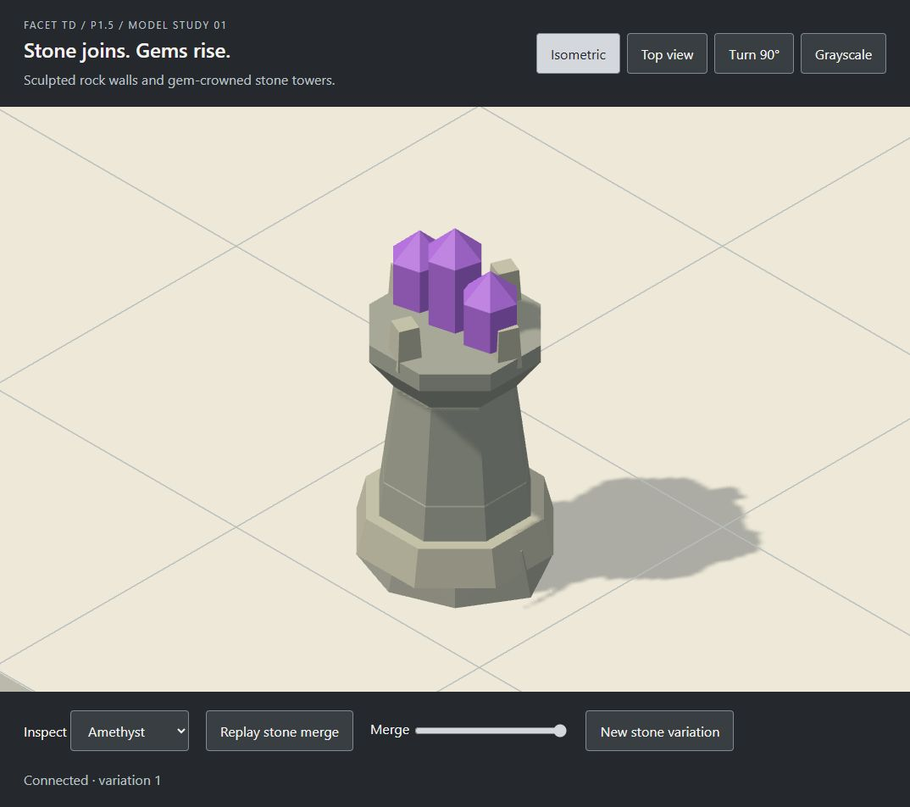

# Stone and basic gem models

Open [the standalone preview](preview/index.html) in a WebGL-capable browser. It contains the renderer and models and needs no network connection.

Use **Replay stone merge** or the **Merge** slider to inspect the wall transition. **New stone variation** changes the boulder silhouette and stone shade. **Inspect** opens each gem at close range. The view controls switch between isometric and top views, rotate by 90 degrees, and remove colour.

This revision replaces the earlier voxel wall style and raises the gems on architectural stone towers. The 1.16-cell tower study supersedes the earlier 0.65-cell socket cap; board occlusion needs review before adoption.

These are real three.js meshes generated by [models.js](models.js). They are an initial model proposal for the game. They do not change gameplay or the accepted board geometry. No files in `src/` are changed.

## Models

- Stone uses a broad irregular boulder and one low faceted ridge per cardinal neighbour. Its height stays at or below 0.20 cell. A stable coordinate/seed hash changes its outline, shoulders and colour.
- Cardinal neighbours extend the stone to the shared cell boundary. Straights, corners, T junctions and crosses use the same generator. Diagonal cells do not join.
- Merge progress extends and raises the connecting ridges over 1.1 seconds in the preview. The slider also supports reverse inspection. Reduced-motion mode switches between endpoints.
- Eight basic gem models stand on tapered stone towers with broad bases, banded shafts and four crown prongs: Diamond D, Sapphire B, Topaz Y, Ruby R, Emerald G, Opal E, Aquamarine Q and Amethyst P.
- Gems use opaque flat shading. Their combined bounds stay within 0.68-cell width/depth and 1.16-cell height. Profiles and crystal counts distinguish the types.

## Reuse in the game

```js
import { createStone, createGemTower } from "./models.js";

const wall = createStone({
  x: 4,
  z: 3,
  seed: 42,
  neighbours: { north: true, east: true },
});
scene.add(wall);
wall.userData.setMerge(0.5); // Presentation progress, independent of simulation ticks.

const emerald = createGemTower("G", { seed: 42 });
emerald.position.set(5, 0, 3);
scene.add(emerald);
```

When adjacency changes, rebuild the affected stone cells with the same seed and animate their merge progress. The game owns neighbour lookup, timing and placement validity. Geometry generation does not belong in `src/sim/`. P2 can adopt these factories into its owned rendering module after art review.

Each mesh owns its geometry. Stone materials are shared and marked with `userData.sharedMaterial`; keep them when removing a model. Gem materials belong to each tower. This study does not batch the entire board. Measure the full board before choosing that optimisation.

## Run and validate

Use the dependencies already installed for the foundation phase. On this art branch, install them from the foundation checkout if `node_modules` is absent; the art study adds no packages.

From the repository root:

```powershell
node node_modules/vite/bin/vite.js --host 127.0.0.1 --port 5175
node docs/art/model-study/models.test.mjs
```

Visit `/docs/art/model-study/index.html` on that server. Rebuild the standalone file after source changes:

```powershell
node --input-type=module -e 'import {build} from "vite"; import {viteSingleFile} from "vite-plugin-singlefile"; await build({root:"docs/art/model-study",configFile:false,plugins:[viteSingleFile()],build:{outDir:"preview",emptyOutDir:false}});'
```

The geometry check covers all 16 cardinal neighbour masks, merge bounds, edge joins, deterministic variation, eight tower bounds and invalid inputs. Browser review covers playback, seed changes, close-ups, both camera modes, quarter-turn rotation and grayscale. Saved screenshots capture the runnable meshes.

Quality tiers, special towers, combat effects, game integration and full-board performance remain outside this first study. Small screens need **Inspect** to see gem detail. The geometric silhouettes are proposals; this study does not establish their readability during combat.



