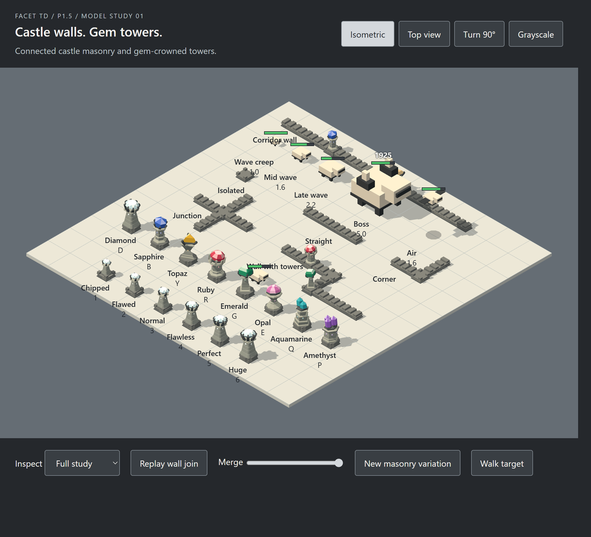
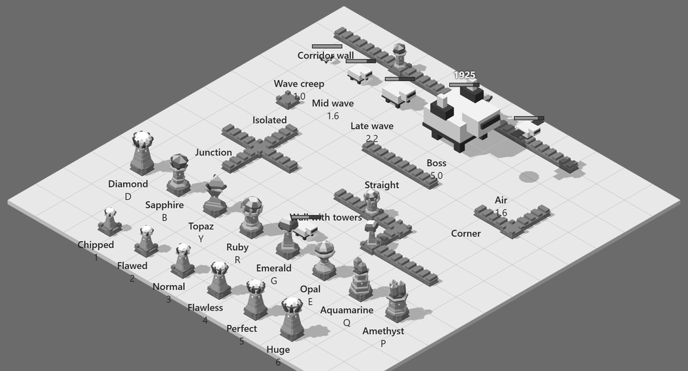
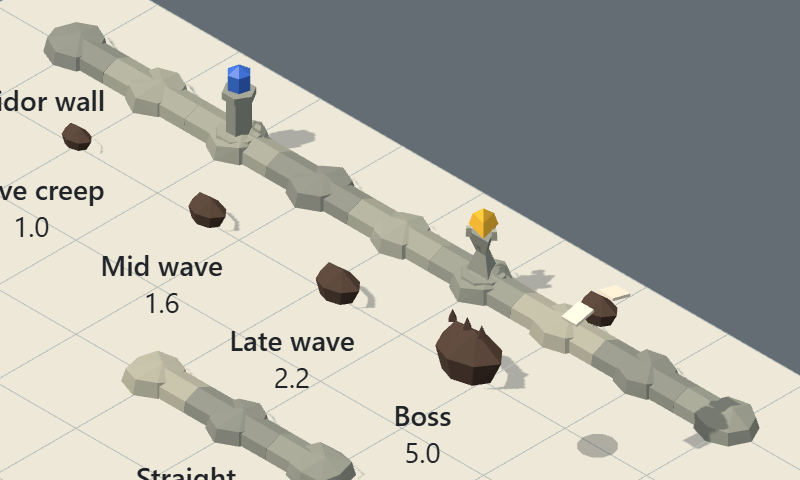

# Castle walls and basic gem models

Open [the standalone preview](preview/index.html) in a WebGL-capable browser. It contains the renderer and models and needs no network connection.

Use **Replay wall join** or the **Merge** slider to inspect the wall transition. **New masonry variation** changes the deterministic block shades and pier bevels. **Inspect** opens each gem at close range. The view controls switch between isometric and top views, rotate by 90 degrees, and remove colour. A creep walks the lane behind the tower rows and every tower aims its head at the nearest creep; **Pause target** stops the walk, and reduced-motion mode starts it paused.

This revision replaces the jagged rock cells with low castle masonry and keeps the gems on architectural towers. Each gem type has its own tower shape, towers join the walls they stand in, and a row shows the Diamond tower at the six quality tiers. Placeholder creeps walk a corridor at their VPK-derived scale.

These are real three.js meshes generated by [models.js](models.js). To build or redesign a tower, follow the [tower model spec](TOWER-SPEC.md). They are an initial model proposal for the game. They do not change gameplay or the accepted board geometry. No files in `src/` are changed.

## Models

- Castle walls use broad bevelled masonry blocks, two staggered courses, a coping band and chunky battlements. They stay below 0.20 cell (top 0.196). Straight/end sections stay narrow; corners, junctions, isolated cells and tower footings use wider piers.
- Cardinal neighbours automatically produce straight walls, corners, T-junctions and crosses. Global brick coordinates align the mortar bond and colours through cell cuts. Coping and footing cross-sections match at every reciprocal boundary. Diagonal cells do not connect.
- The connected pattern is procedural geometry and vertex colours, with no raster texture or extra asset dependency. Use the same world seed for connected cells. The legacy `createStone` name remains for compatibility; `towerBase: true` forces a wider footing and is passed automatically by `createGemTower`.
- Join progress extends and raises connecting wall arms over 1.1 seconds in the preview. The slider also supports reverse inspection. Reduced-motion mode switches between endpoints.
- Eight basic gem models stand on architectural stone towers, each with its own builder, a distinct silhouette and a quality-detail ladder. Diamond and Sapphire retain their approved geometry.
- Diamond D is a square tower of stacked, bevelled stone courses on a battered foot. A pale stone corbel and dark slate claws hold a large brilliant cut, point down: a table, 16 crown facets, a girdle and a pavilion. Fixed ice tones per facet, from vertex colours, make the cut read under flat shading; per-face shade variation does the same for the masonry. Its white star-cut crown and dark claws keep it distinct in grayscale and in top view.
- Sapphire B is a straight, six-sided column of bevelled stone courses on a battered foot, with a wider pale capital. A dark socket and three grips (six from flawless) hold a large pointed blue hexagonal prism; the setting leans with the gem. Flawed adds six face inlays, normal a third course, flawless three more grips and perfect a lower collar band; huge only grows. Shaft and cap palette colours share one vertex-coloured masonry material. At huge it uses 21 meshes, 518 triangles and three materials including the plinth, with a top of 1.105 cells and a creep-visibility margin of 0.104 at rest / 0.096 aimed.
- Topaz Y keeps a three-sided hourglass shaft, triangular capital and three swept dark prongs around a large pointed triangular cut. Flawed adds gold neck inlays, normal a waist collar, flawless a reinforced setting band and perfect a foot band.
- Ruby R is an eight-sided coursed keep with eight pale merlons around a broad cushion-cut gem. Flawed adds face inlays, normal a third course, flawless a parapet band and perfect a lower belt. The merlons and socket tip with the gem and stay seated in the static crown.
- Emerald G is a slim tapered spire with a chamfered square step cut. Four dark corner grips follow the gem's lower bevel from outside, replacing the old intersecting prongs. Flawed adds face inlays, normal a third course, flawless a neck collar and perfect a foot band.
- Opal E is a thin-stemmed goblet with a flared stone bowl, dark bezel and a broad low cabochon. Flawed adds stem inlays, normal a third stem course, flawless a bowl lip and perfect a stem collar.
- Aquamarine Q has three pentagonal terraces and two separate pointed crystals of unequal height. Flawed adds middle-terrace inlays, normal a lower ledge band, flawless two crystal cuffs and perfect a middle ledge band.
- Amethyst P keeps a squat six-sided drum and lip under three evenly spaced crystals. Flawed adds face inlays, normal a third course, flawless a dark rim band and perfect a foot band. Every type only scales up from perfect to huge.
- Towers stand on masonry piers with the same continuous wall arms and brick bond as neighbouring walls. Their plinths use the existing dark wall palette on the shared masonry material. Pass `x`, `z`, `seed` and `neighbours`; `setMerge` animates the joins. Tower shafts, gems, settings and aiming are unchanged.
- `quality` 1–6 (chipped to huge) scales the tower above the stone base uniformly; the base stays wall-sized so its joins meet the cell edge. Widths are 0.38 / 0.44 / 0.50 / 0.56 / 0.62 / 0.68 cell; height caps are 0.68 / 0.78 / 0.87 / 0.97 / 1.06 / 1.16 cell. The Diamond also gains one detail per step: faceted ice lozenges on its top course from flawed, a third course at normal, eight claws instead of four at flawless and a fourth course at perfect; huge only grows. Its height stays below the cap (1.07 at huge) because a taller crown would hide the smallest creep's top.
- Each tower's head (its prongs or claws, and its gems) turns on the shaft axis toward the creep under attack. `userData.aimAt(x, z)` takes a world-space board point: it turns the head to face the point and tips the gems about 10° toward it, so even round gems show their aim. The Diamond's claws and stone tip together; cluster crystals each tip on their own base, so they stay seated. `userData.aimAt()` returns the head to rest. At rest every tower is unchanged.
- Gems use opaque flat shading. Gem profiles and crystal counts reinforce the type.
- `createCreep({ modelScale, flying, boss })` builds a boxy placeholder creep facing +x: light body, dark trim and visor. Body length is `creepSize(modelScale)` = 0.36 × ModelScale cell, so the original size ratios hold; height is 0.66 × length. Air units fly at `FLY_ALTITUDE` (1.35 cell) above a ground shadow. Bosses add shoulder armour. `userData.healthBarY` anchors the HUD health bar; the study shows bars, with the HP number on the boss. These proxies fix scale and readability; creep designs come later.

See [the castle-wall contract](WALLS.md) and [castle-wall connection study](castle-walls.png) for pattern, budgets and joins.

## Reuse in the game

```js
import { createStone, createGemTower } from "./models.js";

const wall = createStone({
  x: 4,
  z: 3,
  seed: 42,
  neighbours: { north: true, east: true },
});
scene.add(wall);
wall.userData.setMerge(0.5); // Presentation progress, independent of simulation ticks.

const emerald = createGemTower("G", {
  x: 5,
  z: 3,
  seed: 42,
  quality: 3, // Normal
  neighbours: { west: true },
});
scene.add(emerald);
emerald.userData.aimAt(creep.position.x, creep.position.z); // Each frame while it attacks; aimAt() rests it.
```

When adjacency changes, rebuild the affected stone cells with the same seed and animate their merge progress. The game owns neighbour lookup, timing and placement validity. It also owns targeting: pick the creep, then aim at its ground position (an air unit's shadow cell). `aimAt` turns the head immediately; to ease the turn, aim at an interpolated point. Geometry generation does not belong in `src/sim/`. P2 can adopt these factories into its owned rendering module after art review.

Each source mesh owns its geometry. Stone materials are shared and marked with `userData.sharedMaterial`; keep them when removing a model. Gem materials belong to each tower. The study renders through [model-batch.js](model-batch.js): static meshes merge by equivalent material and shadow/render flags; repeated moving parts use instancing. Factory objects stay off-scene for targeting, joins and selection. The renderer updates only changed heads, creeps or joins. Inspect and new variations rebuild the rendering copy. Facets, colours and source APIs are unchanged. Dispose the rendering copy before its source resources.

To adopt the batch in the game renderer, add its group directly to an identity scene. Pass the head groups, moving creeps and animated join arms as non-overlapping `dynamicRoots`; call `update(changedRoots)` after their transforms change. Static transforms, visibility, topology and material changes require rebuilding. The module is scoped to these untextured procedural models. Frequent in-game placement/removal should rebuild spatial chunks rather than the whole board.

## Run and validate

The [performance study](performance/RESULTS.md) compares dense boards, instancing, shadows, resolution and a disposable triangle-reduction proxy. Its [benchmark page](performance/index.html) can be rerun in the same Vite server.

Use the dependencies already installed for the foundation phase. On this art branch, install them from the foundation checkout if `node_modules` is absent; the art study adds no packages.

From the repository root:

```powershell
node node_modules/vite/bin/vite.js --host 127.0.0.1 --port 5175
node docs/art/model-study/models.test.mjs
node docs/art/model-study/model-batch.test.mjs
node docs/art/model-study/walls.test.mjs
```

Visit `/docs/art/model-study/index.html` on that server. Rebuild the standalone file after source changes:

```powershell
node --input-type=module -e 'import {build} from "vite"; import {viteSingleFile} from "vite-plugin-singlefile"; await build({root:"docs/art/model-study",configFile:false,plugins:[viteSingleFile()],build:{outDir:"preview",emptyOutDir:false}});'
```

The wall regression checks 768 reciprocal boundary profiles/colours and 48 wall-to-tower transitions. The geometry check covers all 16 cardinal neighbour masks, merge bounds, edge joins, deterministic variation, distinct tower profiles, bounds for all eight types at all six tiers at rest and with the head aimed at eight compass points, heads that lean toward targets from an off-origin cell and rest again, all eight tier-detail ladders, redesigned tower geometry/material budgets and visibility margins, tower bases that match and join their cell's stone, creep sizes for ModelScale 1.0–6.0 (ground creeps up to 5.0 clear corridor walls), health-bar anchors and invalid inputs. It also prints an occlusion probe: it casts rays from the isometric camera at four quarter-turns and one axis-aligned angle to the neighbouring cell centres at creep height. Each cell is checked with the head at rest and aimed at that cell, its worst lean. Chipped and flawed towers hide none. Normal to huge towers hide one, the cell diagonally behind. The check fails if any tower hides more. A second probe aims at the top of the smallest creep: no tower hides it in the four default views, and an axis-aligned view hides it behind one flawless-or-larger tower at most. Browser review covers playback, head tracking, seed changes, close-ups, both camera modes, quarter-turn rotation and grayscale. Saved screenshots capture the runnable meshes.

Creep designs and animation, special towers, combat effects, occluder fading and game integration remain outside this study. Synthetic dense-board rendering is measured in the performance study; actual gameplay frame pacing remains unvalidated. Small screens need **Inspect** to see gem detail. The geometric silhouettes are proposals; this study does not establish their readability during combat.





The historical rock-wall corridor capture below is retained as an earlier scale study; use the current castle-wall captures above for wall styling.



The boss in this close-up hides the Topaz tower behind it. The game must handle that case; see the implementation handoff.
