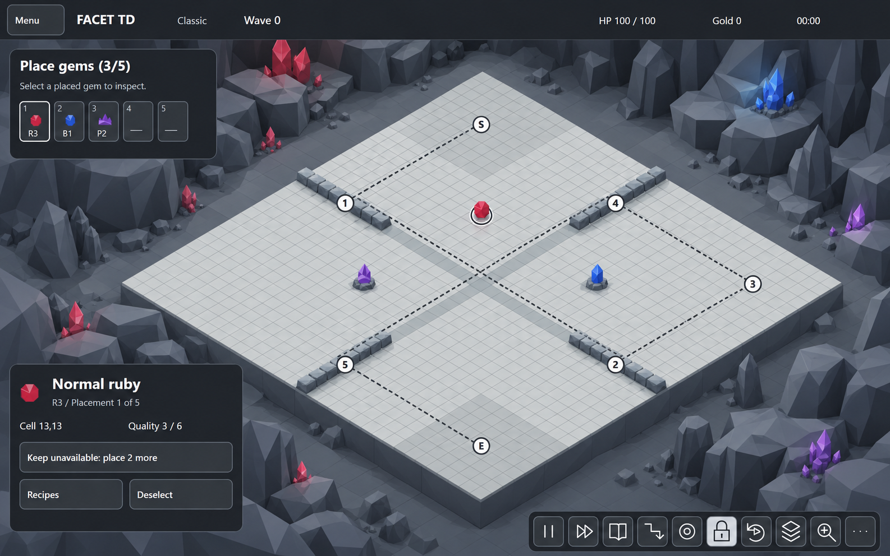
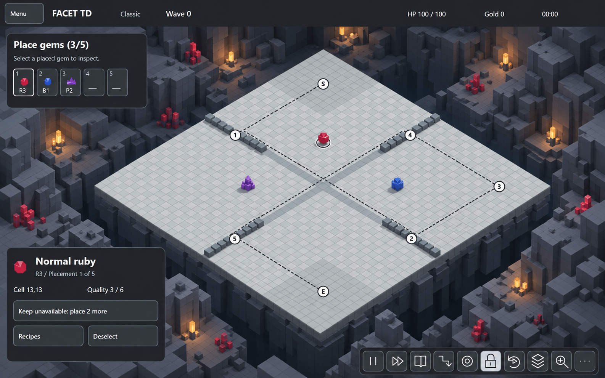
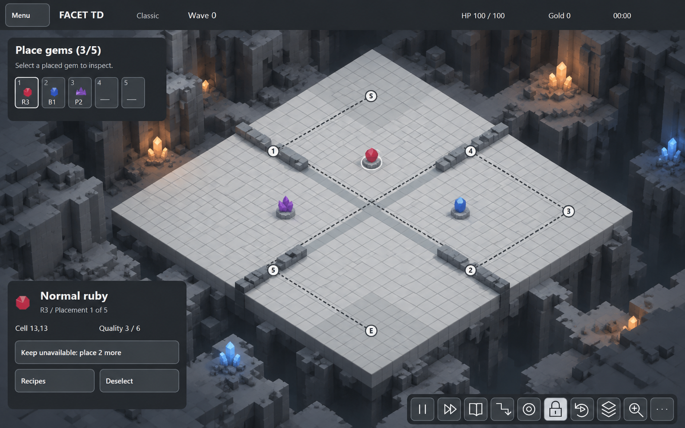
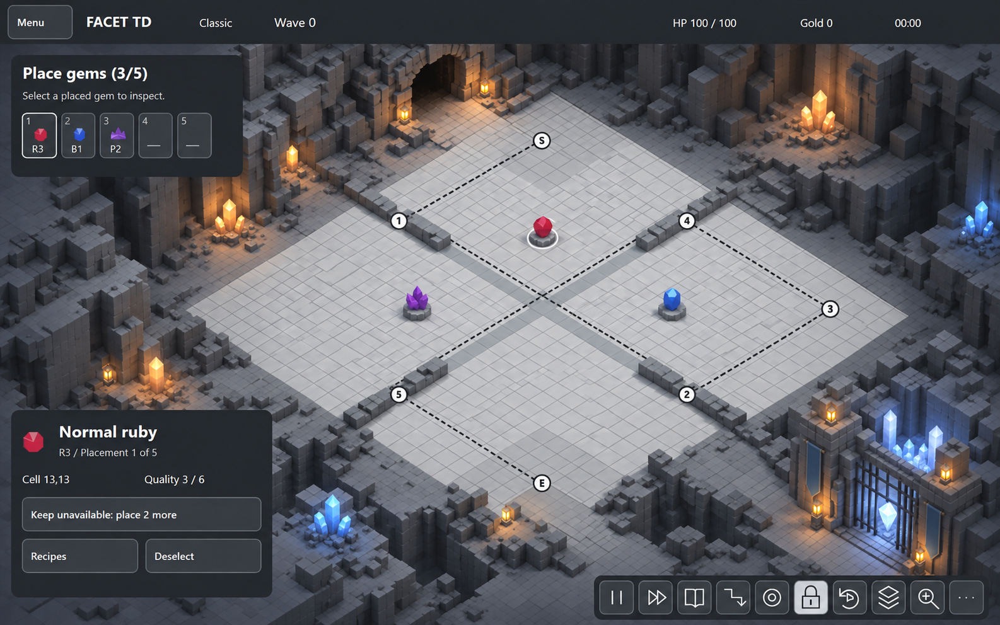

# Cave art-style mockups

25 October 2026. Three comparison concepts produced with the built-in image-generation tool from the same [verified-board desktop composition](../previews/desktop.png). These are options for review; no art-style choice is approved by generating them.

| Option | Mockup | Treatment |
| --- | --- | --- |
| A | [Faceted low-poly](a-faceted.png) | Angular cave rock, polygonal sockets and faceted crystals. |
| B | [Voxel](b-voxel.png) | Strong cubic cave structure, low block walls and stepped gem forms. |
| C | [Hybrid](c-hybrid.png) | Voxel cave rock and sockets, with distinct faceted gems. Recommended comparison candidate. |

All use the cave-grey HUD: five placement slots top-left, selection info bottom-left and icon-only tools bottom-right. The same isometric board composition, checkpoint labels and three illustrative gem placements were supplied as constraints. Visual review found the marker order and main HUD regions recognizable in all three outputs. This is a style comparison, not a pixel-accurate map or implementation specification. The generated tile counts, exact coordinates, typography and model dimensions are not authoritative; [BOARD.md](../BOARD.md) and the source SVGs remain the geometry reference. Top-down and free-rotation presentation will need review after choosing a style.

## Provenance

Created with built-in `image_gen.imagegen`, using `docs/art/previews/desktop.png` as a strict composition reference. The exact generation prompts are saved in [prompts.json](prompts.json). Original generated outputs remain under the Codex generated-images folder; these project copies are the review artifacts. No external art assets were used. The cave dressing explores the proposed style and does not commit the deferred background design.

## Connected entrance and defended destination

[Revised connected-cave mockup](d-connected-hybrid.png) follows the user's request to retain the board's connection to its environment. A tunnel feeds the logical northwest/start corner; the southeast/exit corner connects by stone approach to a defended goal embedded in the cave. The arena now sits within continuous cave floor instead of being an isolated floating island.

The proposed goal is a fortified crystal vault protecting a heart crystal. This is an art interpretation of the original **castle**, not a new rule. Original Lua creates `gemtd_castle` at `path7` (line 2031); enemies reaching the goal reduce `_G.gem_castle_hp` (line 3798). The route remains S → 1 → 2 → 3 → 4 → 5 → castle/exit. The original has five intermediate checkpoints; the goal is the sixth destination after the start.

Generated with built-in `image_gen.imagegen` from C, with the [exact edit prompt](d-connected-hybrid.prompt.json). The user requested the connections; the specific crystal-vault motif is proposed for review. Markers and HUD regions were visually reviewed; exact tile geometry and runtime behavior remain governed by the source references.

[Corrected E-to-castle approach: four isometric rotations and top view](../camera-studies/README.md) supersedes the ambiguous connection in concept D.

## Latest environment correction

No bridge is required at either endpoint. Use unobstructed continuous cave floor, with the entrance and castle embedded in the sunken chamber walls and fixed in world orientation. The [model brief](../environment/MODEL_BRIEF.md) supersedes these details in the retained concept images; the [actual Three.js blockout](../environment/README.md) demonstrates the spatial arrangement.
