# Facet TD UI/UX study

30 October 2026 · `main` at `da21e57` (HUD laid out after Gem TD's Dota 2 HUD, PR 37).

This study reviews the HUD as built, not the P1.5 mockups. It checks the build against the
[direction sheet](../DIRECTION.md) and the viewport list in it. The study changes no code.
Fixes belong to whoever owns `src/hud/` and `src/style.css`.

## Method

- Ran the dev server and drove it with Playwright on Chromium (SwiftShader WebGL), seed 5.
- Captured five viewports from DIRECTION.md: 1440×900, 768×1024, 390×844 (touch), 320×568
  (touch) and 844×390 (touch).
- Captured five states at each viewport: build start, all five gems placed with gem 1 selected
  (keep/combine), about 9 s into wave 1, the settings menu open, and the recipe book open.
- Measured every HUD button smaller than 44 px, every panel the camera fit avoids
  (`data-exclude`), text contrast against the panel colour, and the Tab order.

Limits: one seed, round 1 only; no late-game crowding, end card, hero (WIP) or title screen; no
real device or screen reader; software rendering, so frame rate was not measured.

## What works

- **The board comes first.** At 1440×900 the arena fills the screen, panels sit in the corners, and
  the camera refits when the recipe book opens ([recipes](shots/1440x900-recipes.jpg)).
- **The keep step is easy to read.** The five slots show the gem silhouette, the code (P1, Y1, …)
  and a type-coloured underline. The route preview draws on the board during the pick
  ([keep](shots/1440x900-keep.jpg)).
- **Contrast is good.** Main text is about 15.9:1 and secondary labels about 5.3:1 on charcoal, and
  gold is 11.4:1. All pass WCAG AA.
- **Keyboard coverage is broad.** Every command has a hotkey, shown on the button and exposed with
  `aria-keyshortcuts`. The slots have full accessible names ("Gem 2 of 5: Chipped topaz, cell 14,
  12"), and a live region announces state changes.
- **The settings menu is one clear place.** It groups Game, Camera and Show, labels every toggle in
  text, and shows the hotkey ([menu](shots/1440x900-menu.jpg)).

## Findings

Severity: **P1** blocks or misleads play; **P2** slows or confuses; **P3** polish.

### P1: castle HP and gold disappear at 900 px wide and below

At 900 px and below, `style.css` hides `.showcase` and `.run-stats`. Castle HP and gold then exist
only on the Builder card, as the green bar and the second unlabelled number in the stats column.
That card goes away when anything is selected, and the collapsed card shows neither value.

- 768×1024 and 390×844: visible only while nothing is selected
  ([phone build](shots/390x844-build.jpg)). Selecting a gem hides both
  ([phone keep](shots/390x844-keep.jpg)).
- 320×568 and 844×390: the card starts collapsed, so castle HP and gold never show
  ([320 keep](shots/320x568-keep.jpg), [landscape wave](shots/844x390-wave.jpg)).

DIRECTION.md asks for "two status rows" on phone. **Fix:** keep castle HP and gold in the top
status bar at every width; the round clock has room for both. Drop the duplicate green castle bar
from the Builder card once that is done.

### P1: the short-landscape layout is missing

844×390 uses the same bottom card as portrait. The 76 px clock and 106 px collapsed card leave the
board about 210 px of the 390 px height. The collapsed card shows actions with no label, name or
status ([landscape keep](shots/844x390-keep.jpg)). DIRECTION.md specifies "board left, 240 px
scrollable inspector right; sticky action row". **Fix:** add a `(max-height: 500px) and
(orientation: landscape)` layout that moves the card to a right-hand column and shrinks the clock to
one row.

### P1: phone portrait wastes about a fifth of the screen

At 390×844 the isometric diamond is limited by width. That leaves about 150 px of empty cave between
the board and the card, and cells about 10 px across ([phone build](shots/390x844-build.jpg)). Picking
a cell at that size is guesswork. **Fix (choose one):** open in Top view on portrait, where a square
board uses the height; or zoom portrait to the playable rectangle and pan; or add a
tap-to-magnify loupe for cell picking. Top view by default is the cheapest, and the T toggle already
exists.

### P2: text is far below the type scale

DIRECTION.md sets 16 px body and 14 px secondary. Measured: ability labels ("Shred", "Keep +1")
9 px, slot numbers 9 px, stat and clock labels 10 px, slot codes and bar text 11 px, portrait name
11 px. On phones the stat icons are hidden too, so the Builder column reads as "1 0 1 36" with no
meaning. **Fix:** set a floor of 12 px for labels and 14 px for anything the player must read to
decide (names, refusals, bar text). Keep the icons or add a short label on every stat at every
width.

### P2: touch targets are under 48 px

The direction requires 48×48 px. Measured: Menu 34 px (desktop), 30 px (phone) and 28 px (short
landscape); draft slots 36×44 px on phone; card collapse/expand 24×24 px; commands 46 px on tablet.
**Fix:** use 44 px as an absolute floor and 48 px wherever the layout allows. The slots fit at
5 × 48 px + gaps inside 320 px if the panel spans the width.

### P2: phone shows desktop hotkeys and truncates command names

On touch viewports the cards still show Q/W/K/S hints, while "Place gem" and "Remove stone" are cut
to "Place …" and "Remo…". **Fix:** hide hotkey hints under `(hover: none)` and use that row for the
full name, or use short fixed names ("Place", "Remove").

### P2: the selected gem's name is truncated where the decision is made

The keep card titles the gem "CHIPPED AMETHYS…" (desktop) or "CHIPPED …" (phone), in 11 px capitals.
This is the step where the player compares five gems ([keep](shots/1440x900-keep.jpg)). The card
also has about 270 px of empty space to the right of the actions. **Fix:** move the name into the
card body as a 16 px heading, in sentence case, wrapping to two lines.

### P2: the desktop command card is mostly empty

The card is 760 px wide and holds two commands during build ([build](shots/1440x900-build.jpg)). Its
two full-width bars are unlabelled: green "100 / 100" is castle HP and dark "0 / 5" is gems placed.
Castle HP also shows as "100%" in the showcase, so the two disagree in form. **Fix:** label bars
inline ("Castle 100 / 100", "Gems placed 0 / 5"), or drop the castle bar per the first finding.
Consider narrowing the card to its content during build.

### P2: the recipe book on phone is a floating card

At 390×844 it covers the top half of the board but leaves the board interactive under it, and shows
about 3½ recipes ([phone recipes](shots/390x844-recipes.jpg)). **Fix:** make it a bottom sheet that
replaces the command card while open, with a drag handle and full width.

### P3: the floating panels have no backing

The DPS list ("DPS · WAVE 1 / No damage dealt yet this wave") and the run stats sit on a faint
gradient over busy cave rock ([wave](shots/1440x900-wave.jpg)). They pass contrast on the colour
measured, but over the lit crystals they are harder to read. **Fix:** give both the same charcoal
panel as the round clock.

### P3: abbreviations and repetition

- "K/M" (kills/misses) and "Length" are tooltip-only on a game where tooltips need hover. Use
  "Kills 0 · Leaks 0" and "Maze 115".
- "Frenzied pig" appears in the clock and in the showcase. Keep it in the showcase, where the model
  explains it.
- Two clocks are stacked (run 00:05 over round 00:02) with no labels. Label the small one "Run".

### P3: empty draft slots are faint

Empty slots are dark grey on dark grey with a 9 px number and an em dash
([build](shots/1440x900-build.jpg)). The first thing a new player needs is where the next gem goes.
**Fix:** a dashed outline, with "Q, then pick a cell" in the next empty slot or under the title.

### P3: the hover tooltip stays after a click

After Keep is clicked, the Remove stone tooltip covers the Builder portrait until the pointer moves
([wave](shots/1440x900-wave.jpg)). Hide it on `pointerdown` and after the card changes.

## Priorities

1. Castle HP and gold always visible (P1). Small change; prevents a hidden lose condition.
2. Top view by default on portrait (P1). One line; doubles the cell size.
3. Short-landscape layout (P1). Mid-size CSS change.
4. Type floor and touch-target floor (P2). Mostly CSS variables.
5. Touch-specific labels, the keep-card heading, labelled bars (P2).
6. Phone recipe sheet, panel backing and polish (P2–P3).

## Next checks

These need a later build or a real device:

- Late game: 30+ towers, a full maze and crowded creep health bars against the selected-tower rule.
- The end card and title screen at all five viewports.
- VoiceOver/TalkBack and the cell cursor with a screen reader.
- Real phones for frame rate, safe areas and thumb reach on the card's right-hand actions.

## Screenshots

| | |
| --- | --- |
| 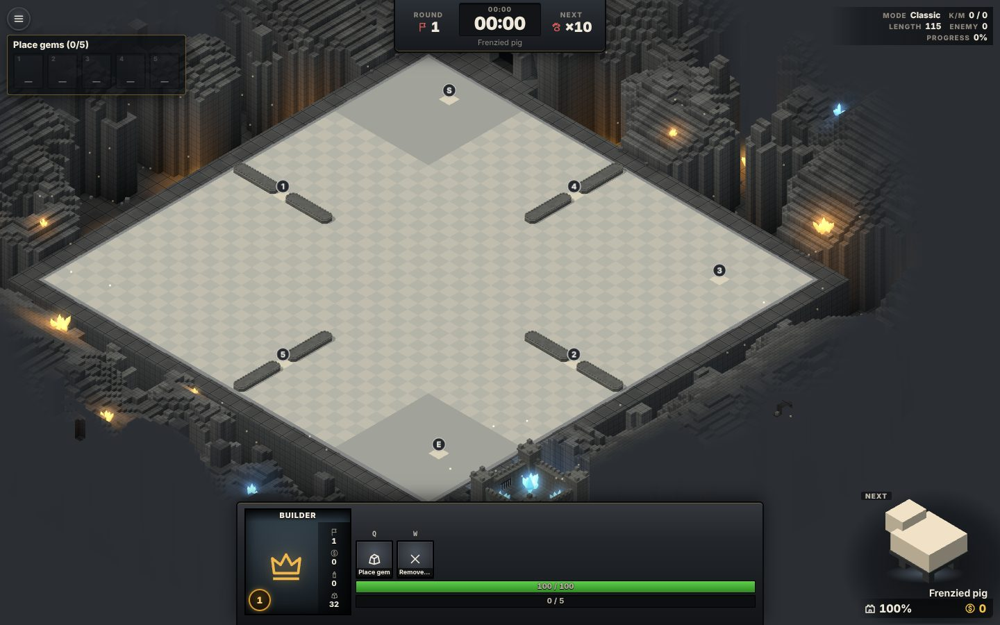 | 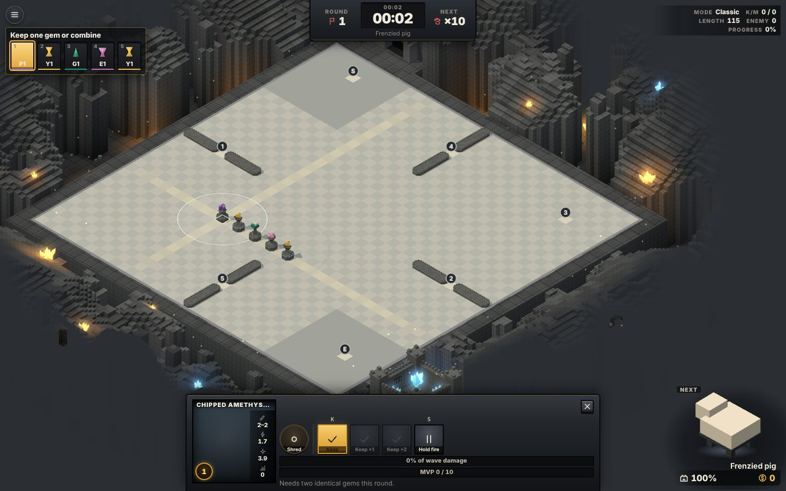 |
| 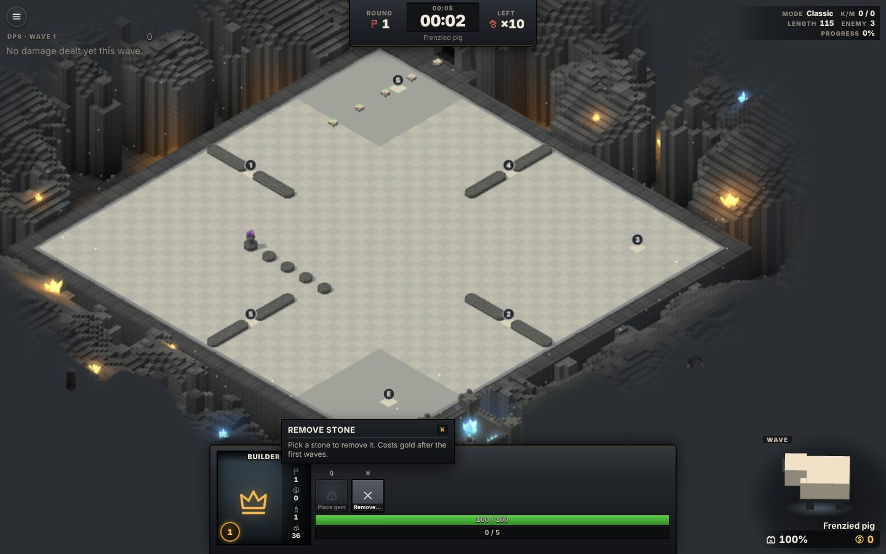 | 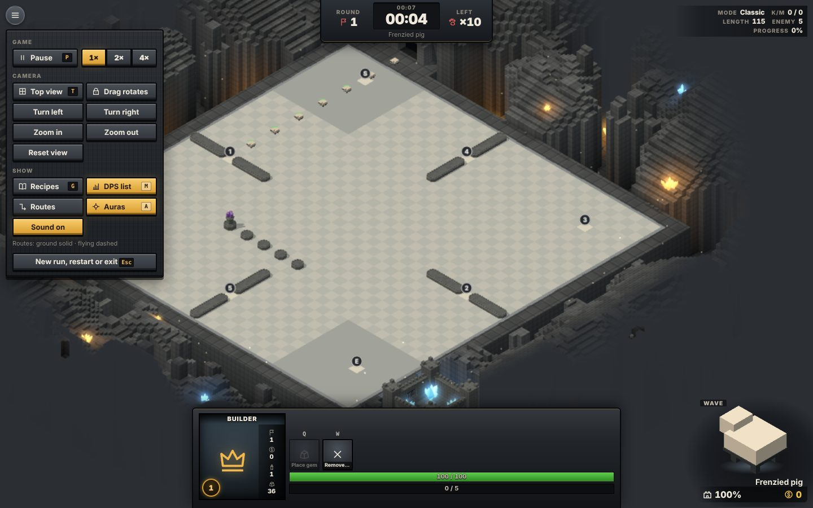 |
| 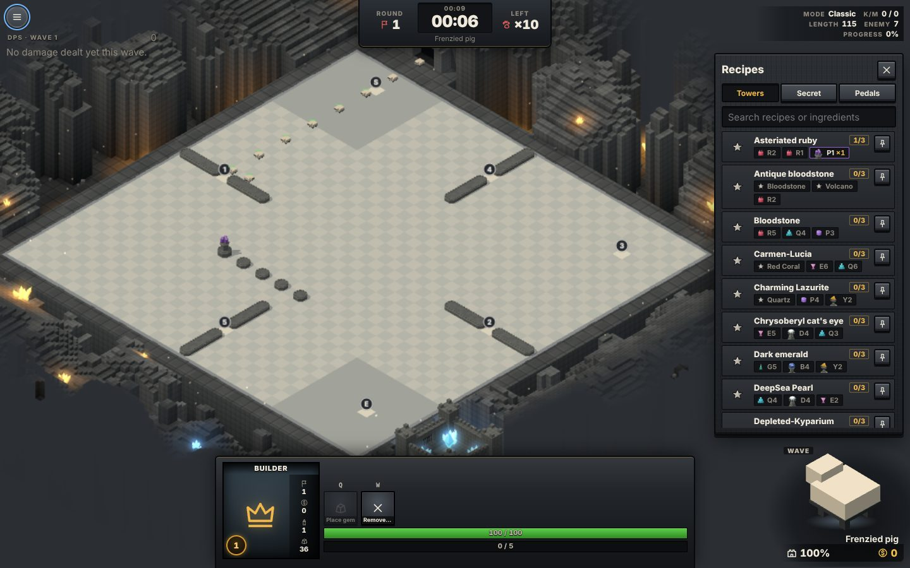 | 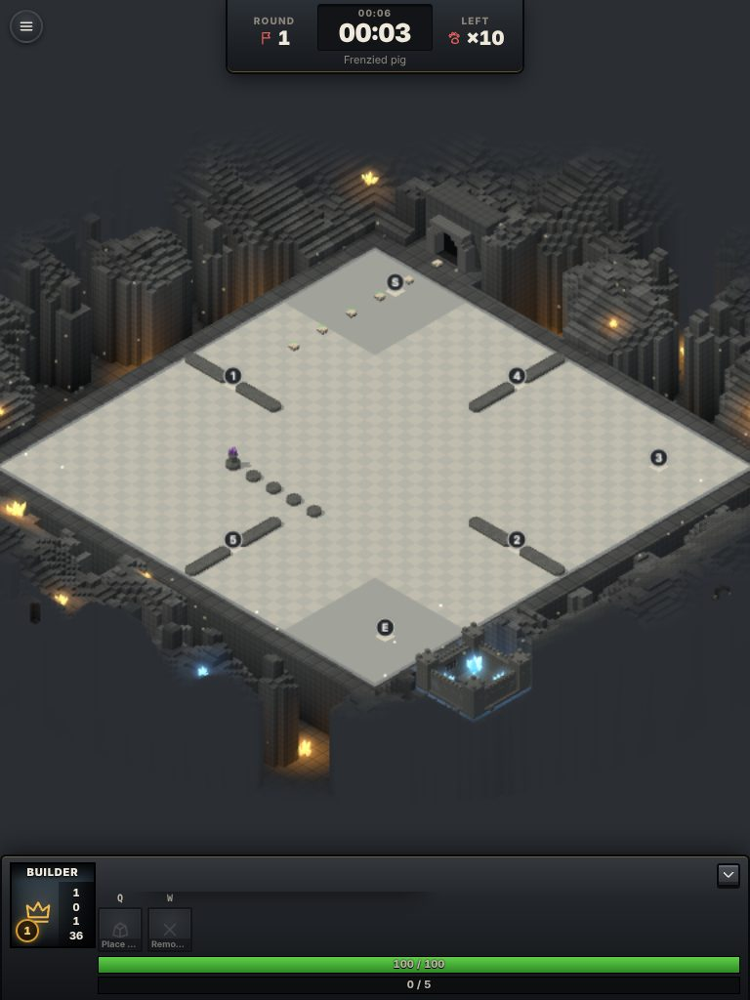 |
| 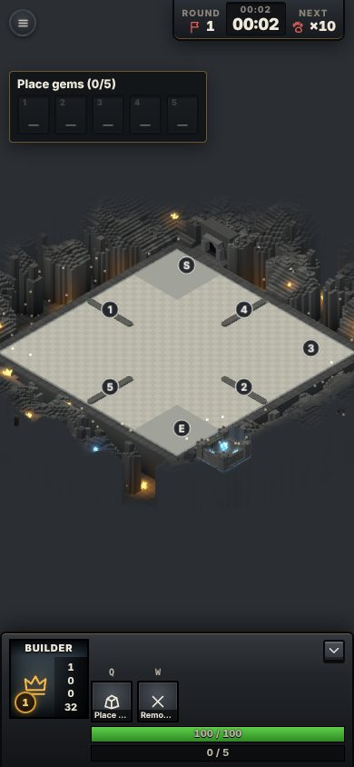 | 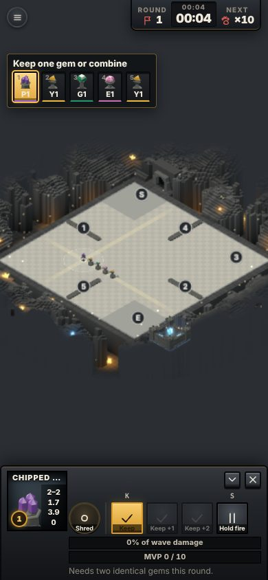 |
| 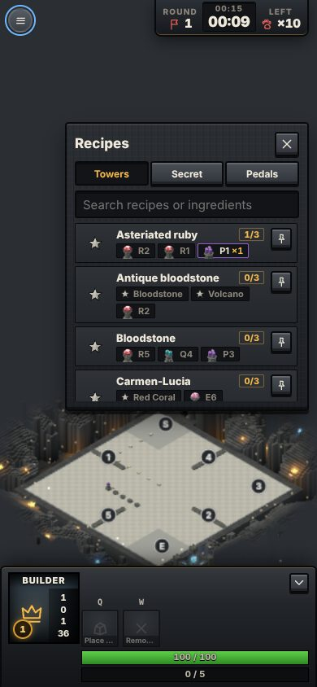 | 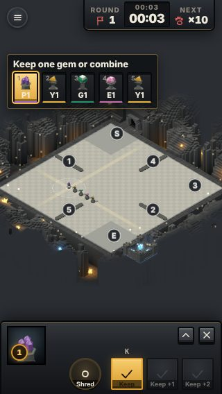 |
| 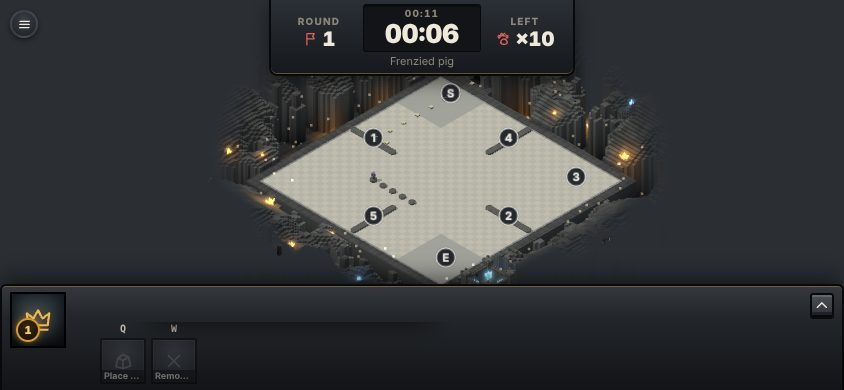 | 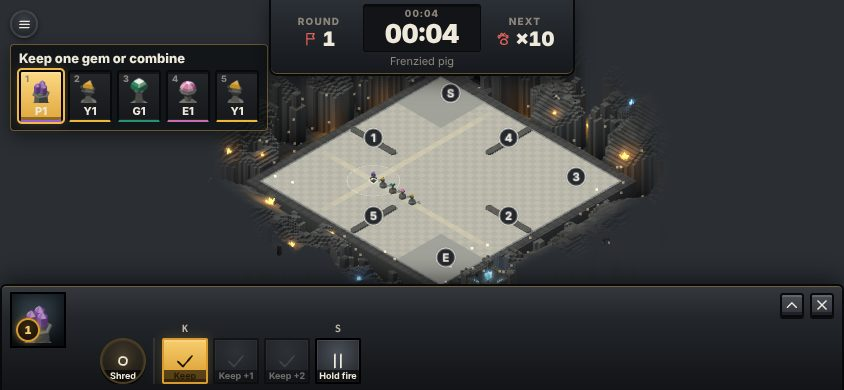 |
