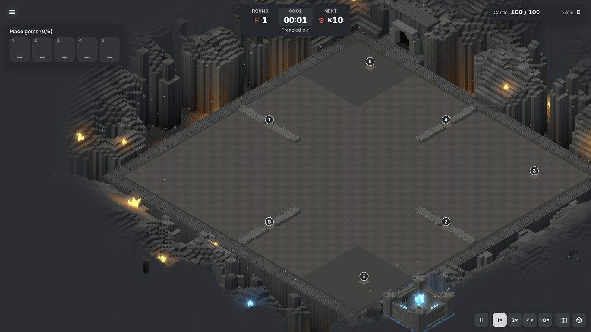
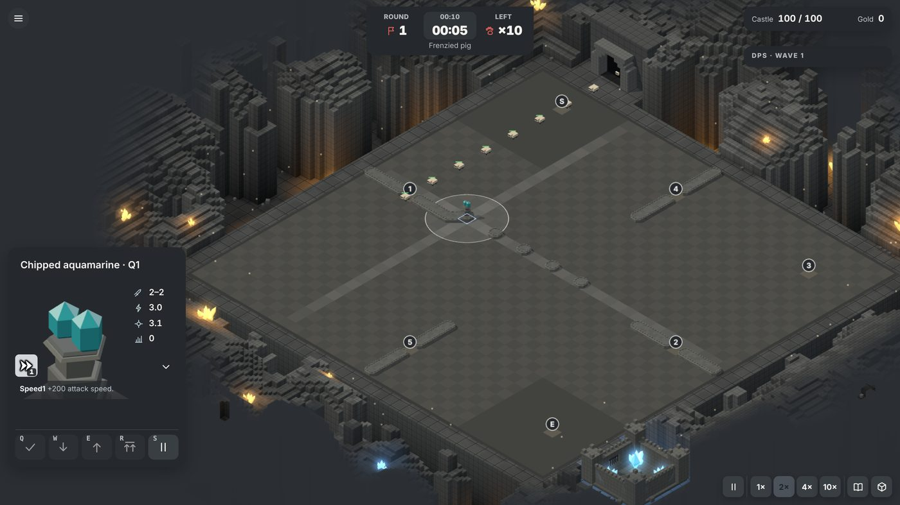
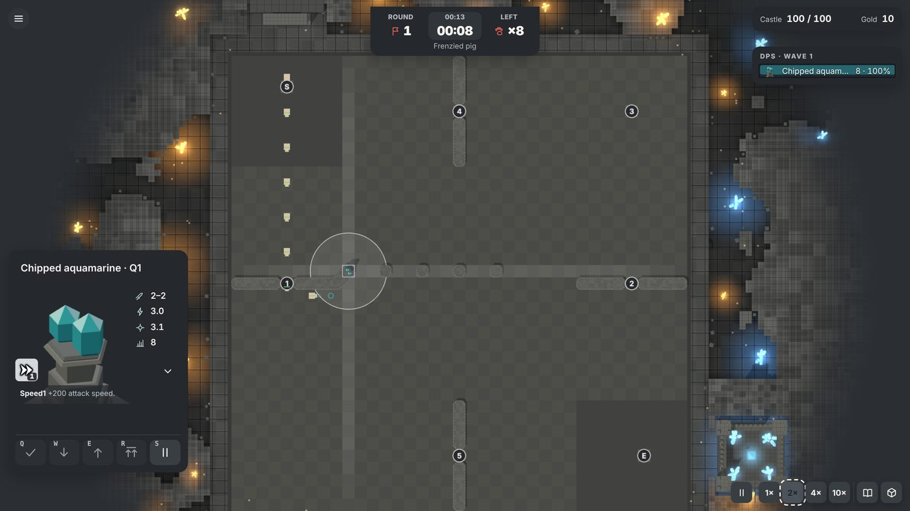
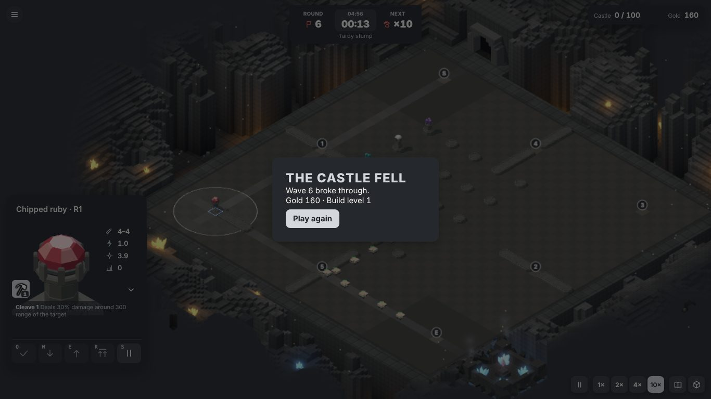
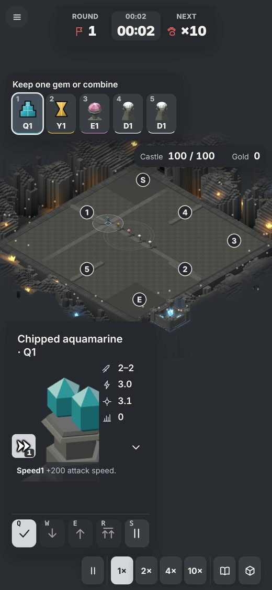
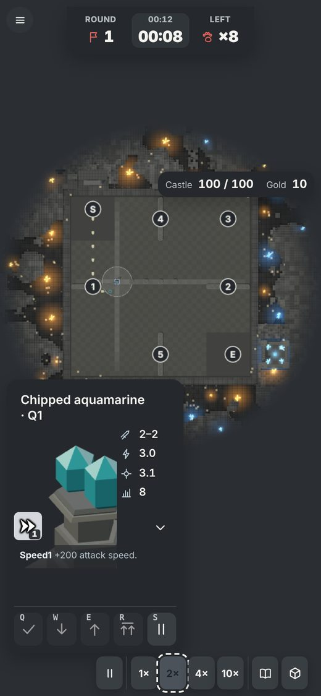
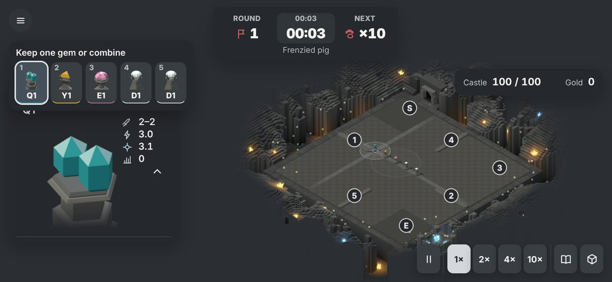

# Classic 1-player audit findings

Audited on commit `0c064e8` (11 November 2026), before any of the work in [README.md](README.md).
File and line references are to that commit. Items marked **fixed** have since landed.

## Interface and UX

Played in headless Chromium at 1366x768, 390x844 and 844x390, in iso and top view. Not exercised:
combining through the UI (the seed never offered one), touch pinch and drag, the blocked-path visual,
audio output.

| # | Severity | Finding | Cause | State |
| --- | --- | --- | --- | --- |
| 1 | Blocker | Every instruction and error is screen-reader-only; refused placements fail silently. | `Hud.tsx:501` `quest sr-only` | Fixed |
| 2 | Major | Double-click or double-tap placement is unreliable (desktop 4/5, phone 2/5) because the board reframes when the first tap opens the card. | `camera.ts:183-195` | Place gem button added; reframe fix unverified |
| 3 | Major | Phone portrait: board is a thin band, card covers the lower half, castle/gold pill sits on the board. | layout | Partly fixed |
| 4 | Major | Phone landscape: cards overlap and clip; settings flyout pushes its last button off-screen. | no short-viewport layout | Open |
| 5 | Major | Touch targets under 44px: menu 32, toolbar 32x40, draft slots 43x57, commands 35-39x40, card toggle 24, recipe pins 26, recipe close 30. | CSS | Partly fixed, unverified |
| 6 | Major | Menu and title lack help, controls, volume, difficulty, hero select, run history, seed entry. Logo wraps at 1366px. | `Menu.tsx` | Help overlay added; rest open |
| 7 | Major | End-of-run card shows only wave and gold; clock keeps running behind it; Play again drops URL flags. | `Hud.tsx:626-655` | Fixed with data available; full stats open |
| 8 | Major | Towers (about 10px) and creeps are tiny at default zoom; pre-placed stones are flat discs; no projectiles or hit effects visible. | models, default fit | Open |
| 9 | Major | Zoom, arrow cursor and B work only with canvas focus. | `camera.ts:215-245` | Fixed |
| 10 | Major | Picking uses the ground plane, so clicking a tall piece in iso can select the cell behind. | `world.ts:516-522` | Fixed |
| 11 | Minor | Damage meter shows an empty header before any damage. | `Hud.tsx:357-360` | Unverified |
| 12 | Minor | Stat rows are icon-only; creep card has an empty slot. | cards | Unverified |
| 13 | Minor | Dashed focus ring after mouse clicks. | `:focus` not `:focus-visible` | Unverified |
| 14 | Minor | Kept tower's card shows disabled draft commands during a wave. | `CommandCard.tsx` | Unverified |
| 15 | Minor | Hidden double-press on 1-5 to keep. | `Hud.tsx:144-176` | Unverified |
| 16 | Minor | No rotate shortcut. | `Hud.tsx:280-281` | Fixed |
| 17 | Minor | Recipe book on phone is a side sheet over the board and card. | CSS | Open |
| 18 | Polish | Floor is a flat grey checker; route bands are faint; waypoint walkways look placeholder. | `environment.ts` | Open |
| 19 | Polish | Top view crops the cave into a blurred mosaic with blank margins. | `environment.ts` | Open |

Shortcuts before this work: 1-5 draft slots, Q/W/E/R gem commands, K keep, C combine, S hold fire,
G recipes, M damage meter, A auras, T view, P pause, Esc; arrows, Enter/Space, B, +/- on canvas
focus. Missing then: restart, new run, speed, Space pause, rotate, reset view, tower cycling, help.

Accessibility: many aria labels, a live region, a keyboard board cursor, reduced-motion handling and
`showModal` dialogs were already in place. Problems: no skip-to-board link, the sr-only notice was in
the tab order, gem type is signalled mostly by colour.

Audio before this work: nine synthesized beeps at a fixed gain, on/off only.

## Performance

Measured under software GL (see README working notes).

| # | Finding | Measured | Cause | State |
| --- | --- | --- | --- | --- |
| 1 | Route search stalls build, keep and combine late game. | Browser, wave 30: 112-191 ms per placement. Node, wave 50: build 115 ms mean (max 446), keep 55, combine 56; `findRoute` p50 54 ms vs 4.3 ms on a typed grid. | `game.ts:795-797` string keys and `gems.some` per probe; `path.ts:33-36` Map/Set A\*; double search on build | Fixed |
| 2 | HUD runs a route search in render while an empty cell is selected. | About 50 ms long task every second. | `CommandCard.tsx:634` `canBuild` in render | Fixed by memo |
| 3 | Any maze change re-merges all walls and redraws the 2048² PCF shadow map. | 33-73 ms JS; frame goes from 172 to 304-334 draw calls. | `pieces.ts:284-369`, `world.ts:458-460` | Chunked re-merge landed; shadow cost not re-measured |
| 4 | Draw calls and triangles grow with towers; no instancing. | Empty 37 calls / 60k tris; wave 10: 90 / 85k; wave 30: 172 / 136k; wave 45: 265-269 / 175-187k. | `pieces.ts:125-176`, `371-395`, `450` | Open |
| 5 | Per-tick strings and allocations proportional to board size. | afterStep 0.5-1.2 ms per tick; 2.4-4.5 ms at 4x. | `pieces.ts:318-340`, `effects.ts:701-705`, `main.tsx` | Fixed |
| 6 | Icon studio: second WebGL context, `toBlob`, forced by a 500 ms idle timeout; about 150 icons on first visit. | Seconds per icon under software GL; not measured on a real GPU. | `TowerIcon.tsx:37-41`, `174` | Fixed |
| 7 | Late waves are not sim-bound. | Wave tick 0.04 ms at wave 1, 0.50 ms at wave 45, p99 at most 1.6 ms. | draw calls, shadows, fixed MSAA (`world.ts:32-57`) | Quality tiers landed; unmeasured on real hardware |
| 8 | Iso/top toggle. | 20-40 ms from raycasting all blockers. | `world.ts:393-407` | Fixed |
| 9 | Bundle. | 4.99 MB, 4.2 MB of it JSON (portraits 1.07 MB, co-op and race entities 1.58 MB, 1p entities 0.63 MB); FCP 1.2-1.4 s, 2.9-3.1 s at 4x throttle. | `src/data/index.ts:3` globs all of `data/baseline` | Fixed: 1.85 MB |

No geometry, texture or heap leak was seen across rounds.

Proposed budget:

| Metric | Laptop | Phone |
| --- | --- | --- |
| Frame | 16.6 ms, p99 25 ms | 16.6 ms, p99 33 ms |
| Draw calls late game, without shadow pass | 120 | 80 |
| Triangles | 150k | 80k |
| Shadow map | 2048², on change | 1024² or blob shadows |
| Pixel ratio | at most 1.5 | at most 1.5, no MSAA |
| Sim per wave tick | 1 ms, max 4 | 2 ms, max 8 |
| Sim per command | 8 ms | 16 ms |
| View afterStep on a maze change | 8 ms | 12 ms |
| Long tasks over 50 ms during play | 0 | 0 |
| Bundle | 1.5 MB raw, 400 KB gzip | same |

## Rules, heroes and gold

**Gold.** Sources: kill bounty only (5 per kill in waves 1-9; 10, 15, 20, 25 in later bands; bosses
150; elites x10; endless 5). No starting gold or wave bonus. A clean 50-wave run earns about 7,500.
Sinks: hero casts (100 to 600 each) and thief creeps (1% at each checkpoint; the tooltip's "10% at
the castle" is wrong). Fixed Hammer costs nothing in the original: its ability has no `cost` value.

**Heroes and skills.** `hero_sea` lists 68 heroes in four tiers (12, 21, 19, 16). `ability_sea`
lists 26 skills in tiers a1-a4, all with 4 levels, plus eight toy letters. Nothing in the data ties a
hero to skills; that came from the online server, as did ownership. The original allowed 1 to 4
skill slots. All 26 skills are implemented in `src/sim/hero.ts` with costs and cooldowns read from
the data. The hero unit has a position, moves at its move speed, must be within 500 units of a cast
target and blocks building within 58 units.

| Id | Key | Name | Cost by level | Cooldown s |
| --- | --- | --- | --- | --- |
| a101 | huichun | Heal | 300 | 10 |
| a102 | shanbi | Evade | 150 | 60 |
| a103 | shouhu | Guard | 200 | 60 |
| a105 | beishuiyizhan | Revenge | 100 | 5 |
| a201-208 | lanse, danbai, baise, hongse, lvse, fense, huangse, zise | Colour prays | 200 | 3 |
| a210 | putong | Common Pray | 200 | 3 |
| a211 | qingyi | Adja-Swap | 200/140/100/80 | 5 |
| a212 | shitou | Stone Henge | 450/375/325/300 | 5 |
| a301 | kuaisusheji | Haste Shoot | 200 | 5 |
| a302 | baoji | Crit | 200 | 5 |
| a303 | miaozhun | Aim | 100 | 5 |
| a304 | fengbaozhichui | Fixed Hammer | free in practice | passive |
| a305 | wuxia | Flawless Pray | 200 | 3 |
| a306 | huidaoguoqu | TimeLapse | 600/500/400/300 | 10 |
| a307 | lianjie | Fatal Bonds | 100 | 5 |
| a308 | xuanfeng | Ursol Whirl | 200/125/75/50 | 5 |
| a401 | yixinghuanwei | Swap | 300/225/175/150 | 3 |
| a402 | wanmei | Perfect Pray | 400 | 3 |
| a403 | guangzhudaobiao | Candy Marker | 375/300/250/225 | 5 |

**Shell economy.** The data says only that shells come "from clearing the game, quests or season
rewards" (1-10 for clearing, 7-day cooldowns). Prices, box odds and earn rates are not in the data.
Proposed, all invented and not yet approved in detail by the owner:

| Item | Proposed |
| --- | --- |
| Shells per run | 1 per 5 waves cleared, +5 for clearing wave 50; x1.5, x2, x3 on difficulty 2, 3, 4; +1 per 5 endless waves |
| Quest reward | 3, 5, 8 shells by quest tier |
| Skill box, 40 shells | Tier odds 55%, 30%, 12%, 3%; a duplicate raises the skill one level (max 4) or refunds 8 |
| Hero box, 30 shells | Tier odds 60%, 28%, 10%, 2%; a duplicate refunds 5 |
| Skill slots | Start with 1; slots 2-4 cost 50, 100, 200 |

**Quests** (all require clearing wave 50; implemented in `src/sim/quests.ts`): q101/q102/q103/q201
never combined Silver, Malachite, Star Ruby, Jade; q105/q209/q302 within 65/55/45 minutes; q106 no
single-round combination; q109 a wave of 20 or more enemies; q110 a pedal upgrade; q202-q208 never
kept a given gem type; q210 a top tower; q211 no hero skills; q304 five MVP-max towers. Retired in
the original: q104, q107, q108, q301, q303. Skipped: q111 (co-op), q398, q399 (challenge tickets).

**Rules checked against the script:** kill gold and XP, castle leak damage, boss leak damage, MVP,
rage start, endless creep buffs, the win at wave 101, a castle fall after wave 50 counting as a win.
All match. `enemy_jimian` is defined but unused. The original forces one boss variant late in the
month by real date; the sim cannot do that deterministically and does not.

**Other gaps:** Bush and Night Challenge modes (large, out of scope), stone-style cosmetics (out of
scope), the 13 `guai_50_ability` effects were matched by name but not re-verified one by one.

## Browser specs failing before this work

On `0c064e8`, 16 of 28 pass. Failing: `abilities.spec:4`, `board.spec:115`, `corner-hud.spec:70`,
`dblclick.spec:19`, `feel.spec:7`, `hero.spec:4`, `hud.spec:31`, `hud.spec:63`, `hud.spec:110`,
`inspect.spec:31`, `inspect.spec:55`, `round.spec:27`. Four of them (`hero.spec:4`, `hud.spec:31`,
`hud.spec:63`, `inspect.spec:31`) hit the 90 s timeout and may be slowness under software GL; the
rest fail in 7 to 41 s and look stale after the corner-HUD reshapes.
